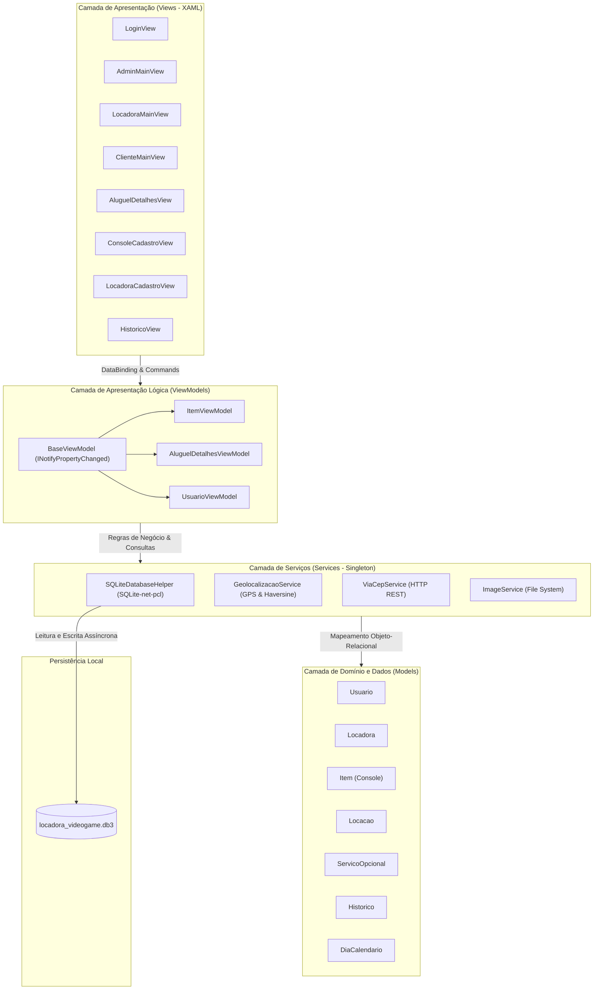
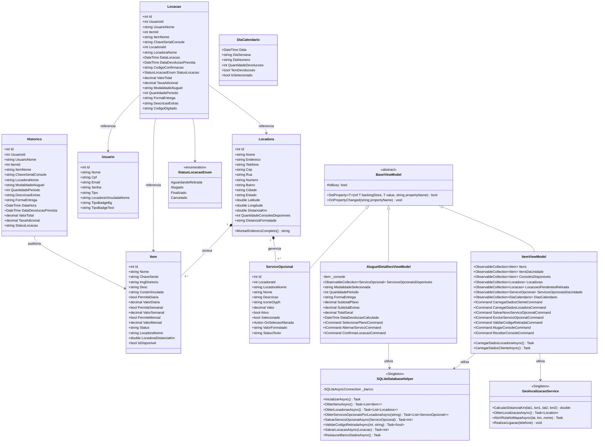
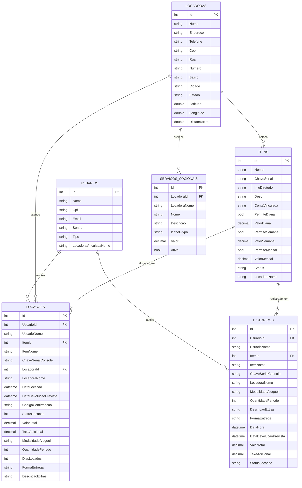
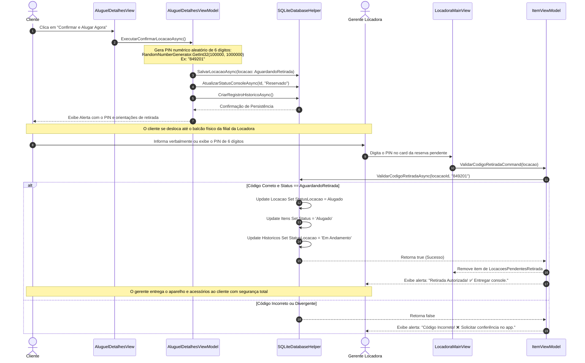
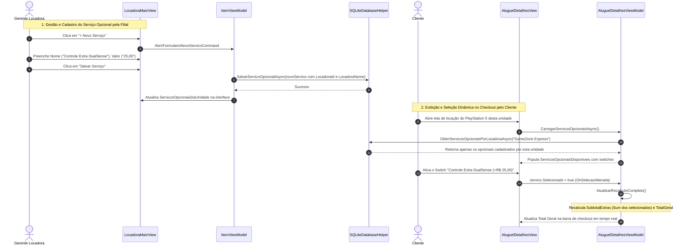
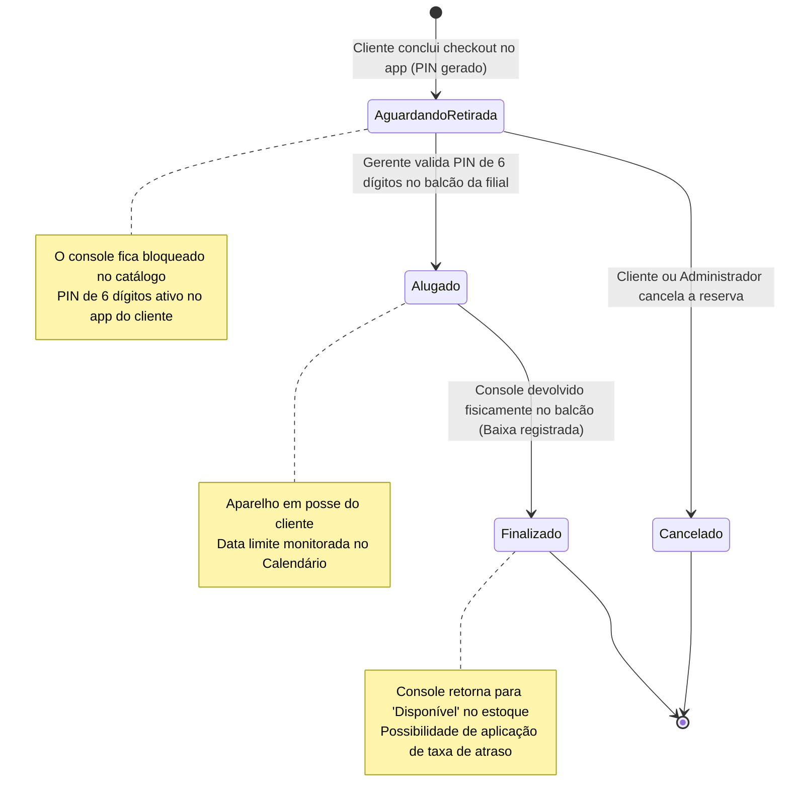

# 📘 Documentação Técnica e Arquitetural — PegaLá (Alugaki)

> **Marketplace Inteligente de Locação e Compartilhamento de Hardware & Consoles de Videogame**  
> *Arquitetura MVVM Pura, Persistência Local SQLite, Geolocalização Reativa e Handshake de Custódia por PIN de 6 Dígitos.*

---

## 📑 Sumário Executivo

1. [Visão Geral do Sistema](#1-visão-geral-do-sistema)
2. [Arquitetura de Software em Camadas (MVVM)](#2-arquitetura-de-software-em-camadas-mvvm)
3. [Diagrama de Casos de Uso (UML Use Case)](#3-diagrama-de-casos-de-uso-uml-use-case)
4. [Diagrama de Classes (UML Class Diagram)](#4-diagrama-de-classes-uml-class-diagram)
5. [Modelo Entidade-Relacionamento (DER / SQLite)](#5-modelo-entidade-relacionamento-der--sqlite)
6. [Diagrama de Sequência: Handshake de Custódia (PIN de 6 Dígitos)](#6-diagrama-de-sequência-handshake-de-custódia-pin-de-6-dígitos)
7. [Diagrama de Sequência: Gestão e Seleção de Serviços Opcionais](#7-diagrama-de-sequência-gestão-e-seleção-de-serviços-opcionais)
8. [Diagrama de Máquina de Estados: Ciclo de Vida da Locação](#8-diagrama-de-máquina-de-estados-ciclo-de-vida-da-locação)
9. [Matriz de Permissões e Perfis de Acesso (RBAC)](#9-matriz-de-permissões-e-perfis-de-acesso-rbac)
10. [Módulos e Serviços de Infraestrutura](#10-módulos-e-serviços-de-infraestrutura)

---

## 1. Visão Geral do Sistema

O **PegaLá (Alugaki)** é uma plataforma mobile de locação de consoles de videogame e equipamentos de entretenimento desenvolvida sobre o framework **.NET MAUI 9.0** e linguagem **C# 13**. O ecossistema atua como um hub logístico e marketplace conectando três atores principais:

1. **Administrador Geral**: Gestor global da plataforma, responsável pelo cadastro e auditoria de filiais/locadoras, catálogo mestre de consoles, gerenciamento de usuários e monitoramento das métricas financeiras consolidadas.
2. **Gerente de Locadora (Unidade/Filial)**: Administra o estoque local de aparelhos, configura planos de locação (diária, semanal, mensal), gerencia o catálogo exclusivo de **Serviços Opcionais** da sua filial, valida a retirada física de consoles no balcão através do código de segurança PIN e dá baixa em devoluções via calendário interativo de 14 dias.
3. **Cliente**: Explora o catálogo de consoles e filiais ordenados dinamicamente pela proximidade GPS (Fórmula de Haversine), simula e contrata aluguéis customizados, escolhe opcionais e forma de entrega, e obtém seu PIN de segurança com acompanhamento via widget flutuante estilo iFood.

---

## 2. Arquitetura de Software em Camadas (MVVM)

O projeto adota rigorosamente o padrão de arquitetura **MVVM (Model-View-ViewModel)** em sua forma **pura e manual**, sem dependência de bibliotecas geradoras de código ou reflexão mágica (como CommunityToolkit), garantindo previsibilidade, portabilidade e aderência estrita aos conceitos de orientação a objetos:

- **Views (XAML & Code-behind Limpo)**: Telas declarativas com DataBinding compilado (`x:DataType`), estilizadas com paleta Light Mode moderna e ícones vetoriais da biblioteca FontAwesome Solid (`FontFamily="FontAwesomeSolid"`). O code-behind (`.xaml.cs`) é estritamente restrito à inicialização de componentes e chamadas de ciclo de vida (`OnAppearing`).
- **ViewModels (`BaseViewModel`)**: Camada intermediária que gerencia estado e regras de apresentação. Herdam de `BaseViewModel`, que encapsula a interface `INotifyPropertyChanged` e o método `SetProperty<T>()`.
- **Models**: Classes POCO anotadas com atributos SQLite (`[Table]`, `[PrimaryKey]`, `[AutoIncrement]`, `[Ignore]`).
- **Services (Singleton)**: Componentes assíncronos que isolam persistência em banco local, consultas de CEP, geolocalização nativa e armazenamento de imagens.

---

## 3. Diagrama de Casos de Uso (UML Use Case)

O diagrama abaixo detalha todos os casos de uso do ecossistema, segmentados pelos 3 perfis de atores:

```mermaid
flowchart LR
    %% Atores
    Admin((Administrador))
    Locadora((Gerente Locadora))
    Cliente((Cliente))

    %% Casos de Uso Administrador
    subgraph UC_Admin ["Módulo de Administração Geral"]
        UC1["Visualizar Dashboard Financeiro Geral"]
        UC2["Cadastrar / Editar Filiais de Locadoras"]
        UC3["Consultar Endereço por CEP (ViaCEP)"]
        UC4["Obter Coordenadas GPS da Unidade"]
        UC5["Gerenciar Catálogo Geral de Consoles"]
        UC6["Excluir Usuários / Locatários"]
        UC7["Restaurar / Limpar Base de Dados (Seed)"]
    end

    %% Casos de Uso Locadora
    subgraph UC_Locadora ["Módulo Operacional da Filial"]
        UC8["Acompanhar Faturamento da Filial"]
        UC9["Cadastrar / Editar Consoles da Própria Loja"]
        UC10["Configurar Planos (Diária, Semanal, Mensal)"]
        UC11["Cadastrar Serviços Opcionais da Loja"]
        UC12["Ativar / Pausar Serviços Opcionais"]
        UC13["Validar Retirada via PIN de 6 Dígitos"]
        UC14["Acompanhar Calendário de Devoluções (14 Dias)"]
        UC15["Registrar Recebimento e Aplicar Taxa de Atraso"]
    end

    %% Casos de Uso Cliente
    subgraph UC_Cliente ["Módulo do Cliente"]
        UC16["Autenticar / Criar Nova Conta"]
        UC17["Explorar Consoles Ordenados por GPS"]
        UC18["Filtrar Consoles por Locadora Específica"]
        UC19["Traçar Rota no Mapa até a Loja"]
        UC20["Ligar para a Unidade"]
        UC21["Configurar Aluguel (Período & Quantidade)"]
        UC22["Selecionar Serviços Opcionais da Unidade"]
        UC23["Escolher Modalidade de Entrega (Balcão / Delivery)"]
        UC24["Gerar PIN de Confirmação de 6 Dígitos"]
        UC25["Acompanhar Retirada via Widget Flutuante / PIN"]
        UC26["Consultar Histórico de Locações"]
    end

    %% Conexões Administrador
    Admin --> UC1
    Admin --> UC2
    Admin --> UC3
    Admin --> UC4
    Admin --> UC5
    Admin --> UC6
    Admin --> UC7

    %% Conexões Locadora
    Locadora --> UC8
    Locadora --> UC9
    Locadora --> UC10
    Locadora --> UC11
    Locadora --> UC12
    Locadora --> UC13
    Locadora --> UC14
    Locadora --> UC15

    %% Conexões Cliente
    Cliente --> UC16
    Cliente --> UC17
    Cliente --> UC18
    Cliente --> UC19
    Cliente --> UC20
    Cliente --> UC21
    Cliente --> UC22
    Cliente --> UC23
    Cliente --> UC24
    Cliente --> UC25
    Cliente --> UC26
```

### Especificação dos Casos de Uso Críticos

| ID | Caso de Uso | Ator Primário | Pré-condição | Fluxo Principal | Pós-condição |
| :--- | :--- | :--- | :--- | :--- | :--- |
| **UC13** | **Validar Retirada com PIN** | Gerente Locadora | Locação no status `AguardandoRetirada` | Gerente digita PIN de 6 dígitos informado pelo cliente no balcão; sistema confere integridade atômica no SQLite | Status da locação muda para `Alugado`, console é marcado como indisponível no catálogo |
| **UC21** | **Configuração da Locação** | Cliente | Console disponível | Cliente define modalidade habilitada pela loja (Diária, Semanal ou Mensal), escolhe quantidade de períodos e revisa data de devolução | Totais de diárias calculados reativamente |
| **UC22** | **Seleção de Opcionais** | Cliente | Loja possuir opcionais ativos | Cliente marca opcionais (ex: controle extra, headset, seguro); sistema atualiza `SubtotalExtras` e `TotalGeral` | Opcionais anexados ao resumo e persistidos |
| **UC11** | **Gestão de Serviços Opcionais** | Gerente Locadora | Usuário autenticado como Locadora | Gerente informa nome, descrição e valor diário; escolhe ícone glyph | Opcional fica disponível no checkout de todos os consoles daquela filial |

---

## 4. Diagrama de Classes (UML Class Diagram)

O diagrama a seguir exibe as relações de herança, associações de domínio, coleções observáveis e métodos de persistência:

---

## 5. Modelo Entidade-Relacionamento (DER / SQLite)

O banco de dados SQLite local (`locadora_videogame.db3`) é estruturado em tabelas normalizadas com chaves primárias e relacionamentos conceituais:

---

## 6. Diagrama de Sequência: Handshake de Custódia (PIN de 6 Dígitos)

O mecanismo de segurança inspirado no protocolo de retenção e custódia de plataformas de entrega e transporte (ex: iFood, BlaBlaCar) garante que o console físico só seja entregue após validação do código numérico de 6 dígitos gerado criptograficamente na reserva:

---

## 7. Diagrama de Sequência: Gestão e Seleção de Serviços Opcionais

Fluxo que permite à unidade cadastrar serviços e adicionais customizados e ao cliente selecioná-los no checkout:

---

## 8. Diagrama de Máquina de Estados: Ciclo de Vida da Locação

Controle estrito dos estados da locação definidos pelo enum `StatusLocacaoEnum`:

---

## 9. Matriz de Permissões e Perfis de Acesso (RBAC)

O sistema conta com autenticação e autorização por perfil (`Usuario.Tipo`), garantindo isolamento total de recursos:

| Funcionalidade / Recurso | Administrador (`Admin`) | Gerente Locadora (`Locadora`) | Cliente (`Cliente`) |
| :--- | :---: | :---: | :---: |
| **Dashboard Consolidado da Rede** | ✅ Total | ❌ | ❌ |
| **Dashboard Operacional da Unidade** | ❌ (Redirecionado) | ✅ Apenas sua filial | ❌ |
| **Cadastro e Edição de Filiais** | ✅ Total | ❌ | ❌ |
| **Consulta de Endereço por CEP (ViaCEP)** | ✅ Sim | ❌ | ❌ |
| **Cadastro de Consoles no Estoque** | ✅ Para qualquer loja | ✅ Apenas para sua loja | ❌ |
| **Definição de Preços (Diária/Semanal/Mensal)**| ✅ Sim | ✅ Sim | ❌ |
| **Cadastro de Serviços Opcionais** | ❌ | ✅ Exclusivo de sua filial | ❌ |
| **Validação de Retirada (PIN 6 Dígitos)** | ❌ | ✅ Exclusivo de sua filial | ❌ |
| **Baixa de Devoluções / Calendário 14 Dias** | ❌ | ✅ Exclusivo de sua filial | ❌ |
| **Catálogo de Consoles por GPS mais Próximo** | ❌ | ❌ | ✅ Sim |
| **Seleção de Opcionais & Checkout** | ❌ | ❌ | ✅ Sim |
| **Widget Flutuante de Retirada (PIN)** | ❌ | ❌ | ✅ Sim |
| **Histórico de Locações** | ✅ Geral | ✅ Da filial | ✅ Próprias locações |
| **Restaurar Banco de Dados (Seed Inicial)** | ✅ Sim | ❌ | ❌ |

---

## 10. Módulos e Serviços de Infraestrutura

### 10.1. `SQLiteDatabaseHelper` (Persistência Transacional)
- **Tecnologia**: Pacote NuGet `sqlite-net-pcl`.
- **Padrão**: Singleton assíncrono com conexão thread-safe compartilhada (`_banco`).
- **Resiliência**: Tratamento de exceções, criação automática de índices por chave primária, seeds controlados por contagem inicial (`CountAsync() == 0`).
- **Caminho Físico**: `FileSystem.AppDataDirectory/locadora_videogame.db3`.

### 10.2. `GeolocalizacaoService` (Cálculo Espacial e Mapas)
- **Fórmula de Haversine**:
  $$\Delta\sigma = 2 \cdot \arcsin\left(\sqrt{\sin^2\left(\frac{\Delta\phi}{2}\right) + \cos(\phi_1)\cos(\phi_2)\sin^2\left(\frac{\Delta\lambda}{2}\right)}\right)$$
  $$d = R \cdot \Delta\sigma \quad (\text{onde } R = 6.371\text{ km})$$
- **Integração com Sistema Operacional**: Disparo nativo de rotas no aplicativo de mapas padrão (`Map.Default.OpenAsync`) e discagem telefônica direta (`PhoneDialer.Default.Open`).

### 10.3. `ViaCepService` (Automação Cadastral)
- Consumo assíncrono da API aberta `https://viacep.com.br/ws/{cep}/json/` via `HttpClient`.
- Extração de Logradouro, Bairro, Localidade e UF com sanitização de caracteres não-numéricos.

### 10.4. `ImageService` (Gerenciamento de Ativos Gráficos)
- Interface de seleção nativa (`FilePicker.PickAsync`) para imagens `.png`, `.jpg`, `.jpeg` e `.webp`.
- Cópia segura e persistência no diretório de dados da aplicação (`FileSystem.AppDataDirectory`), desacoplando o sistema de caminhos temporários voláteis.

---

**Projeto Desenvolvido com Padrões de Engenharia de Software de Alto Nível**  
*Documentação técnica homologada para fins acadêmicos, de portfólio e auditoria de código.*

