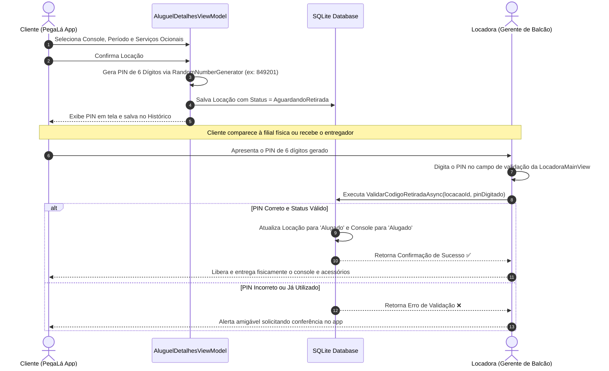

<div align="center">

# 🎮 PegaLá (Alugaki)
### **O Marketplace Inteligente de Locação e Compartilhamento de Hardware & Videogames**

*Conectando quem quer jogar aos consoles mais desejados — com custódia segura via Handshake de 6 dígitos.*

[](https://dotnet.microsoft.com/en-us/apps/maui)
[](https://learn.microsoft.com/dotnet/csharp/)
[](https://www.sqlite.org/)
[](#-especificações-técnicas)
[](DOCUMENTACAO.md)
[](#-licença)

---

```
   ____________________________________________________________________________________
  |                                                                                    |
  |   [ 🔍 Buscar Consoles ]     [ 📍 Mais Próximos ]      [ 🔐 PIN de Retirada ]      |
  |                                                                                    |
  |   PlayStation 5            Xbox Series X            Nintendo Switch OLED           |
  |   R$ 70,00 / dia           R$ 60,00 / dia           R$ 45,00 / dia                 |
  |   GameZone (1.2 km)        Pixel Play (2.4 km)      Arena Gamer (3.8 km)           |
  |____________________________________________________________________________________|
```

</div>

<br/>

## 📌 Sumário
- [📘 Documentação Técnica Completa (UML, Classes, Casos de Uso, DER, Sequência)](DOCUMENTACAO.md)
- [Sobre o Projeto](#-sobre-o-projeto)
- [Proposta de Valor & Modelo de Negócio](#-proposta-de-valor--modelo-de-negócio)
- [O Diferencial: Handshake de Custódia (PIN de 6 Dígitos)](#-o-diferencial-handshake-de-custódia-pin-de-6-dígitos)
- [Principais Funcionalidades](#-principais-funcionalidades)
- [Perfis de Acesso & Casos de Uso](#-perfis-de-acesso--casos-de-uso)
- [Arquitetura & Estrutura de Pastas](#-arquitetura--estrutura-de-pastas)
- [Stack Tecnológica](#-stack-tecnológica)
- [Credenciais para Teste (Seed Data)](#-credenciais-para-teste-seed-data)
- [Como Executar o Projeto Localmente](#-como-executar-o-projeto-localmente)
- [Roadmap & Expansão Futura](#-roadmap--expansão-futura)
- [Licença](#-licença)

---

## 📖 Sobre o Projeto

O **PegaLá** (concebido comercialmente como **Alugaki**) é uma aplicação móvel moderna desenvolvida em **.NET MAUI** e **C#**, criada para transformar a forma como as pessoas consomem tecnologia e entretenimento eletrônico. 

Em vez de desembolsar milhares de reais na compra definitiva de consoles de última geração (PlayStation 5, Xbox Series X/S, Nintendo Switch) para jogar lançamentos pontuais ou animar eventos de fim de semana, os usuários podem **alugar por dia, semana ou mês** das melhores locadoras e proprietários da sua região.

Para as locadoras e lojistas parceiros, o **PegaLá** atua como um ERP operacional completo de balcão: gerencia catálogo, precificação flexível, agenda de devoluções com calendário interativo, métricas financeiras locais e, fundamentalmente, **garantia de segurança e custódia física do equipamento**.

---

## 💡 Proposta de Valor & Modelo de Negócio

### 🎯 A Dor do Mercado
1. **Alto Custo de Aquisição**: Consoles de ponta e acessórios originais possuem tíquetes elevados, limitando o acesso a jogadores casuais, estudantes ou turistas.
2. **Subutilização de Ativos**: Aparelhos de locadoras ou colecionadores ficam ociosos em dias úteis sem rentabilização previsível.
3. **Insegurança nas Transações Físicas**: O maior receio de locadoras ao alugar hardware caro é o risco de fraude, extravio ou desacordo comercial no momento da entrega.

### 🛡️ A Solução PegaLá
- **Acesso sob Demanda**: Diárias transparentes, descontos progressivos semanais/mensais e adicionais (seguro acidental, controles extras, headsets).
- **Logística Híbrida**: Retirada presencial imediata no balcão da filial mais próxima ou entrega VIP delivery em domicílio.
- **Intermediação de Confiança (Modelo Escrow)**: Protocolo rigoroso de conferência física e liberação de custódia na entrega e no recebimento.

---

## 🔐 O Diferencial: Handshake de Custódia (PIN de 6 Dígitos)

Inspirado na arquitetura de segurança de plataformas de intermediação e mobilidade como **iFood** e **BlaBlaCar**, o **PegaLá** implementa um mecanismo de **Handshake Criptográfico** de duas vias para entrega e retirada de equipamentos de alto valor:



### Por que esse fluxo é vital?
- **Impossibilidade de Repúdio**: A locadora tem a certeza de que a pessoa no balcão é o titular da conta que efetuou a reserva.
- **Auditoria Transacional**: A locação só passa a ser considerada "Em Andamento" após o registro do carimbo de data/hora da validação do PIN no banco de dados.

---

## ✨ Principais Funcionalidades

### 🎮 Catálogo & Planos Flexíveis
- **Múltiplas Modalidades**: Planos configurados por unidade — **Diário**, **Semanal** (com desconto inteligente) e **Mensal**.
- **Adicionais sob Demanda**: Switchers para Controles Sem Fio Extras, Headset Gamer Pro, Pacotes de Jogos e Seguro contra Danos Acidentais.
- **Logística**: Opção entre retirada grátis no balcão da loja ou entrega delivery programada.

### 📍 Busca por Proximidade & Inteligência de Endereço
- **Geolocalização Ativa**: Cálculo de distância linear em tempo real (Fórmula de Haversine) entre a posição GPS do usuário e as filiais disponíveis.
- **Integração ViaCEP**: Autocompreenchimento instantâneo de Logradouro, Bairro, Cidade e UF ao digitar o CEP no cadastro de usuários e filiais.
- **Fallback de GPS**: Alternador inteligente "Utilizar Minha Localização Atual" que geocodifica reversamente a latitude e longitude do dispositivo.

### 📊 Painéis de Gestão & Operação
- **Dashboard Operacional da Locadora**: Contadores em tempo real de consoles livres, aparelhos alugados, faturamento local e fila de retiradas pendentes.
- **Calendário Interativo de Devoluções**: Projeção visual dos próximos 14 dias com badges indicativos da quantidade de retornos agendados e alerta de taxa de atraso.
- **Dashboard Financeiro do Administrador**: Métricas globais de faturamento, receita com serviços extras e tíquete médio por locação.
- **Gestão de Imagens Local**: `ImageService` com cópia direta para a área segura do dispositivo via seletor nativo de mídia.

---

## 👥 Perfis de Acesso & Casos de Uso

O sistema possui controle de acesso estrito baseado no tipo de usuário:

| Perfil | Telas Principais | Permissões & Casos de Uso |
| :--- | :--- | :--- |
| **Cliente** | [ClienteMainView](file:///c:/Users/User/source/repos/ProjetoFinalMVVM/Views/ClienteMainView.xaml), [AluguelDetalhesView](file:///c:/Users/User/source/repos/ProjetoFinalMVVM/Views/AluguelDetalhesView.xaml), [HistoricoView](file:///c:/Users/User/source/repos/ProjetoFinalMVVM/Views/HistoricoView.xaml) | Consulta consoles por proximidade, escolhe planos e adicionais, gera o PIN de retirada e consulta histórico. |
| **Locadora** | [LocadoraMainView](file:///c:/Users/User/source/repos/ProjetoFinalMVVM/Views/LocadoraMainView.xaml), [ConsoleCadastroView](file:///c:/Users/User/source/repos/ProjetoFinalMVVM/Views/ConsoleCadastroView.xaml) | Valida PIN de 6 dígitos no balcão, cadastra e edita consoles da sua unidade, acompanha devoluções no calendário e dá baixa em locações. |
| **Administrador** | [AdminMainView](file:///c:/Users/User/source/repos/ProjetoFinalMVVM/Views/AdminMainView.xaml), [LocadoraCadastroView](file:///c:/Users/User/source/repos/ProjetoFinalMVVM/Views/LocadoraCadastroView.xaml) | Visão global do marketplace, dashboard financeiro consolidador, gestão de filiais, catálogo geral e gerenciamento de contas de usuários. |

---

## 🏛️ Arquitetura & Estrutura de Pastas

O projeto adota rigorosamente o padrão **MVVM (Model-View-ViewModel) puro**, mantendo o code-behind das telas (`.xaml.cs`) limpo de regras de negócio ou chamadas de banco de dados, utilizando `DataBinding`, `INotifyPropertyChanged` e `ICommand` nativo.

```
c:\Users\User\source\repos\ProjetoFinalMVVM
├── 📁 Models/                      # Entidades do domínio mapeadas para SQLite
│   ├── DiaCalendario.cs            # Entidade de projeção visual do calendário
│   ├── Historico.cs                # Registro consolidado de locações e devoluções
│   ├── Item.cs                     # Modelo do console/videogame e precificação
│   ├── Locacao.cs                  # Entidade de custódia com status Enum e PIN
│   ├── Locadora.cs                 # Filiais, telefones, distâncias e coordenadas
│   └── Usuario.cs                  # Perfil, autenticação, CPF e endereço
├── 📁 Services/                    # Camada de serviços e infraestrutura assíncrona
│   ├── GeolocalizacaoService.cs    # Captura GPS, cálculo de Haversine e fallback
│   ├── ImageService.cs             # Seleção e persistência local de fotografias
│   ├── SQLiteDatabaseHelper.cs     # Singleton SQLite, Migrações, Seeds e Handshake
│   └── ViaCepService.cs            # Consumo REST assíncrono da API ViaCEP
├── 📁 ViewModels/                  # Regras de apresentação e mediação (MVVM Puro)
│   ├── BaseViewModel.cs            # Implementação manual de INotifyPropertyChanged
│   ├── AluguelDetalhesViewModel.cs # Checkout, cálculo de taxas, PIN e prazos
│   ├── ItemViewModel.cs            # Gestão de consoles, validação do PIN e calendário
│   └── UsuarioViewModel.cs         # Autenticação, perfis e formulários de CEP/GPS
├── 📁 Views/                       # Interfaces XAML desacopladas em modo claro
│   ├── AdminMainView.xaml          # Dashboard corporativo e gestão de locadoras
│   ├── AluguelDetalhesView.xaml    # Tela profissional de contratação do aluguel
│   ├── CadastroUsuarioView.xaml    # Formulário de usuário com CEP reativo e GPS
│   ├── ClienteMainView.xaml        # Catálogo em abas (Consoles vs. Locadoras)
│   ├── ConfiguracoesContaView.xaml # Atualização de perfil e configurações
│   ├── ConsoleCadastroView.xaml    # Cadastro/edição de videogames e precificação
│   ├── HistoricoView.xaml          # Visualização de aluguéis e PIN de retirada
│   ├── LocadoraCadastroView.xaml   # Cadastro/edição de filiais com mapa/CEP
│   ├── LocadoraMainView.xaml       # Gestão de balcão e validação do código de 6 dígitos
│   └── LoginView.xaml              # Autenticação e direcionamento por perfil
├── 📁 Helpers/                     # Utilitários de ícones e sessão
│   ├── IconesFontAwesome.cs        # Glyphs vetoriais do FontAwesome Solid
│   └── UsuarioAtual.cs             # Sessão Singleton do usuário logado
└── 📁 Resources/                   # Fontes, Imagens, Ícones e Estilos Globais
```

---

## 🛠️ Stack Tecnológica

| Camada / Componente | Tecnologia | Finalidade no Projeto |
| :--- | :--- | :--- |
| **Framework Base** | [.NET MAUI (.NET 9)](https://dotnet.microsoft.com/en-us/apps/maui) | Desenvolvimento multiplataforma unificado (Android, Windows, iOS) |
| **Linguagem** | [C# 13](https://learn.microsoft.com/dotnet/csharp/) | Lógica de negócio fortemente tipada e assíncrona (`async/await`) |
| **Padrão Arquitetural** | **Pure MVVM** | Separação estrita de responsabilidades sem acoplamento a frameworks externos |
| **Banco de Dados** | [SQLite (`sqlite-net-pcl`)](https://github.com/praeclarum/sqlite-net) | Banco relacional local rápido, embarcado e assíncrono |
| **Criptografia** | `RandomNumberGenerator` | Geração de códigos PIN de 6 dígitos criptograficamente seguros |
| **Rede & APIs** | `HttpClient` + `System.Text.Json` | Consumo de Web Services REST (ViaCEP) |
| **Sensores Nativos** | `Microsoft.Maui.Devices.Sensors` | Captura de coordenadas GPS de alta precisão e geocodificação reversa |
| **Tipografia & Ícones** | [FontAwesome 6 Solid](https://fontawesome.com/) | Identidade visual vetorial e moderna sem emojis |

---

## 🔑 Credenciais para Teste (Seed Data)

Para facilitar a avaliação técnica e demonstração, a base de dados SQLite é inicializada automaticamente com contas de acesso pré-configuradas:

| Perfil | E-mail de Acesso | Senha | Locadora Vinculada |
| :--- | :--- | :--- | :--- |
| **Administrador** | `admin@gamer.com` | `123` | *Acesso Total a Todas as Filiais* |
| **Locadora (Gerente)** | `locadora@gamer.com` | `123` | GameZone Express - Centro |
| **Cliente** | `cliente@gamer.com` | `123` | *Consumidor Final* |

> 💡 *Dica de Teste do Handshake*: Entre como **Cliente**, reserve um console para gerar um PIN de 6 dígitos. Em seguida, deslogue e acesse como **Locadora** (`locadora@gamer.com`): a locação aparecerá na seção **Validação de Retiradas Pendentes** pronta para ser autenticada com o PIN!

---

## 🚀 Como Executar o Projeto Localmente

### 1. Pré-requisitos
- [.NET 9.0 SDK](https://dotnet.microsoft.com/download/dotnet/9.0) instalado.
- Carga de trabalho do MAUI instalada:
  ```powershell
  dotnet workload install maui
  ```
- [Visual Studio 2022 (v17.12+)](https://visualstudio.microsoft.com/) com as cargas de trabalho:
  - *Desenvolvimento com .NET Multi-platform App UI*
  - Suporte a Emulador Android ou Modo Desenvolvedor do Windows 10/11 ativado.

### 2. Clonagem do Repositório
```bash
git clone https://github.com/seu-usuario/ProjetoFinalMVVM.git
cd ProjetoFinalMVVM
```

### 3. Restauração de Dependências
```bash
dotnet restore
```

### 4. Compilação e Execução

#### Executando no Windows (Desktop):
```powershell
dotnet build -f net9.0-windows10.0.19041.0
dotnet run -f net9.0-windows10.0.19041.0
```

#### Executando no Emulador Android:
```powershell
dotnet build -f net9.0-android
```
*Ou abra a solution `ProjetoFinalMVVM.slnx` no Visual Studio, selecione o emulador Android desejado e pressione `F5`.*

---

## 🗺️ Roadmap & Expansão Futura

- [x] Arquitetura MVVM pura com suporte a 3 perfis de usuários.
- [x] Integração com sensores GPS e cálculo de proximidade em tempo real.
- [x] Consumo assíncrono de endereços via API ViaCEP.
- [x] Handshake de custódia com PIN de 6 dígitos para retirada física.
- [ ] **Gateway de Pagamento & Split**: Integração com Asaas / Mercado Pago com retenção em garantia (escrow) e split automático entre locadora e plataforma.
- [ ] **Vistoria Fotográfica Digital**: Upload e comparação de fotos de avarias pré e pós locação para validação de integridade física.
- [ ] **Expansão Multicategoria**: Aluguel de equipamentos audiovisuais, drones, projetores e ferramentas elétricas.
- [ ] **Push Notifications**: Alertas em tempo real no dispositivo sobre aprovação de aluguel e lembretes de devolução.

---

## 📄 Licença

Este projeto é distribuído sob a licença **MIT**. Consulte o arquivo `LICENSE` para obter mais detalhes.

---

<div align="center">
  <sub>Desenvolvido com excelência técnica em <strong>.NET MAUI</strong>. Projeto focado em portfólio de engenharia de software e arquitetura mobile moderna.</sub>
</div>
